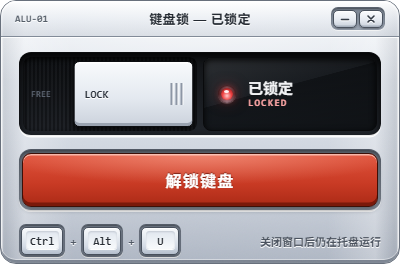

# 键盘锁 KeyboardLock

临时锁住笔记本自带键盘，**鼠标和滚轮完全不受影响**。

适合这些场景：在键盘上垫书/纸张写字、清理键盘、防猫踩键盘、给小孩看视频时防止乱按。

| 未锁定 | 已锁定 |
|---|---|
|  |  |

## 特点

- **只锁键盘，不碰鼠标**：只安装 `WH_KEYBOARD_LL` 键盘钩子，全程没有任何鼠标钩子
- **Ctrl + Alt + U 一键锁 / 解**，也可以直接用鼠标点界面里的按钮
- **可选开机静默启动**：勾选后会在「启动」文件夹放一个快捷方式，开机自动在托盘里待命、不弹窗口；仍保持「不写注册表」，想关掉随时删快捷方式或在任务管理器「启动」里禁用
- **关窗口收进托盘**：点右上角 `–` 最小化到任务栏，点 `×` 只是隐藏到通知区域，键盘不会因此解锁；要彻底退出请右键托盘图标 →「完全退出」
- 锁定期间窗口自动置顶，随时能点到解锁按钮
- 关掉进程或从托盘退出，键盘**立刻**恢复；`Ctrl + Alt + Del` 任何时候都能用
- 快捷键按**虚拟键码**匹配，不受输入法、键盘布局影响
- 便携单文件：免安装、免管理员权限、不写注册表、不联网

## 下载

到 [Releases](../../releases) 下载：

| 资产 | 说明 |
|---|---|
| `KeyboardLock-v2.1.0.zip` | 完整包：解压后是 `KeyboardLock.exe` + `使用说明.txt` |
| `KeyboardLock.exe` | 单独的可执行文件，想直接替换旧版时用这个 |

解压后双击 `KeyboardLock.exe` 即可，免安装、不需要管理员权限。

需要 Windows 10 / 11（使用系统自带的 .NET Framework 4.x，常规系统均已内置）。界面由 GDI+ 原生自绘，**不再依赖 Edge WebView2 运行时**，精简版 / LTSC 系统同样可用。

> 从 v1.x 升级：v1.x 的旧版本仍在历史 Release 里保留，但**请直接换成 v2.1.0**——它是原生自绘版，不需要 Edge WebView2 运行时，也不再往 `%LocalAppData%` 释放任何 DLL。

## 使用

1. 双击 `KeyboardLock.exe`
2. 点「锁定键盘」，或按 `Ctrl + Alt + U`
3. 解锁：再按一次 `Ctrl + Alt + U`，或用鼠标点「解锁键盘」按钮

锁定期间所有按键（包括 Win、Alt+Tab、媒体键）都不会传给系统，但鼠标移动、点击、滚轮一切正常。

### 托盘

- 点窗口右上角的 `–`：最小化到任务栏
- 点窗口右上角的 `×` 或按 `Alt+F4`：窗口收进通知区域（"显示隐藏的图标"里），**锁定状态保持不变**
- 左键单击托盘图标、或再双击桌面快捷方式：重新显示窗口
- 右键托盘图标：显示主界面 / 锁定·解锁 / **完全退出**（只有这里才会真正结束进程）

## 工作原理

用 `SetWindowsHookEx(WH_KEYBOARD_LL)` 装一个全局低层键盘钩子：

- 非修饰键在锁定期间直接吞掉（`return 1`），不调用 `CallNextHookEx`
- **修饰键（Ctrl / Alt / Shift / Win）只吞"按下"，一定放行"抬起"**

第二条是 v1.1.0 修的关键 bug。锁定瞬间 Ctrl/Alt 的按下事件已经被系统接收，如果连抬起也吞掉，系统会永远认为 Ctrl 处于按下状态——于是滚轮变成 Ctrl+滚轮，桌面上滚一下就缩放图标、网页里滚一下就缩放页面，表现为"滚轮也被锁了"。

配合同样按虚拟键码匹配的快捷键，以及按住不放只触发一次的防抖，整套逻辑不依赖字符转换和系统按键状态，因此不会因为输入法或键盘布局而失效。

## 已知限制

- 仅 Windows 10 / 11
- 锁的是**整个系统**的键盘，不是某一个窗口
- 有窗口以管理员权限运行并处于前台时（UAC 提示、以管理员身份启动的程序），非提权进程的钩子收不到按键，此时锁定无效——这是 Windows 的安全机制，不是 bug
- exe 未做代码签名，从网络下载后首次运行可能触发 SmartScreen 提示，点「更多信息 → 仍要运行」
- 部分杀毒软件对"键盘钩子"敏感，可能误报。源码就在本仓库，可自行核对、自行编译

## 自行编译

需要 Windows + .NET Framework 4.x（`csc.exe` 随系统提供）：

```powershell
.\build.ps1
```

产物在 `dist\KeyboardLock.exe`。

也可以用 .NET SDK 构建（需要 `dotnet` 命令，会从 NuGet 取 net48 参考程序集）：

```powershell
dotnet build
```

两种方式编译的是同一套源码。

## 更新日志

**v2.1.0**
- 新增：**开机静默启动**（托盘右键菜单「开机静默启动」可开关）：在「启动」文件夹放一个带 `--silent` 参数的快捷方式，开机自动驻留托盘、不弹窗口，快捷键照常可用
- 优化：自启项指向当前 exe，exe 挪目录或换版本后启动时自动自愈
- 保持「不写注册表」：自启项就是一个快捷方式，删掉即失效

**v2.0.0**
- 重构：界面改为 **GDI+ 原生自绘**，新增 `src/AluPanelRenderer.cs` 总装与 `src/alu/` 分层绘制模块（机身 / 标题栏 / 滑块槽 / 状态灯 / 主键 / 页脚），彻底移除 WebView2 依赖
- 优化：不再需要 Edge WebView2 运行时，精简版 / LTSC 系统同样可用；exe 体积与内存占用显著下降
- 优化：界面按 DPI 等比自绘，高分屏下文字与图形同步缩放
- 优化：删除内嵌 DLL 自释放逻辑，不再向 `%LocalAppData%` 写入任何文件

**v1.3.0**
- 重做：苹果早期 / 博朗高精拟物风界面（CNC 阳极氧化铝合金外壳、机械拨动滑块、LED 状态窗、博朗红/象牙白主按键、微凹立体键帽）
- 重做：全新四键位铝合金机械键帽图标（`Lock` + `U` + `Ctrl` + `Alt`）
- 优化：无边框圆角窗体原生拖拽与单文件自释放 WebView2 运行时集成

**v1.2.0**
- 新增：关闭窗口收进托盘，右键托盘图标「退出」才真正结束进程
- 新增：托盘双击/左键唤起窗口；重复双击桌面图标也会唤起已运行的实例
- 重做：拟物风图标（3D 键盘 + 锁，圆角遮罩）
- 重做：界面视觉（状态胶囊、圆角主按钮、主题色随状态切换）

**v1.1.0**
- 修复：锁定后 Ctrl/Alt 状态残留，导致滚轮变成 Ctrl+滚轮（桌面图标缩放 / 网页缩放）
- 修复：按住 `Ctrl+Alt+U` 不放时快捷键被自动重复触发，反复锁/解
- 修复：切换置顶时抢焦点，打断正在使用的程序
- 修复：高 DPI 屏幕上窗口过小
- 改进：钩子安装失败时给出明确提示并禁用按钮

**v1.0.0**
- 首个版本

## License

[MIT](LICENSE)
