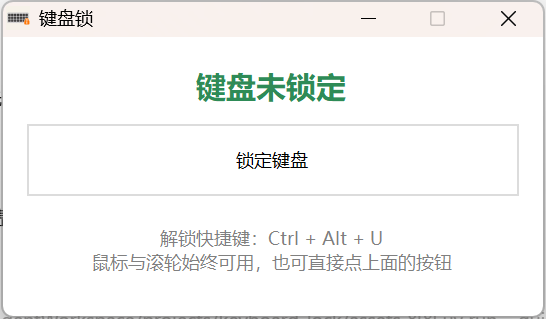

# 键盘锁 KeyboardLock

临时锁住笔记本自带键盘，**鼠标和滚轮完全不受影响**。

适合这些场景：在键盘上垫书/纸张写字、清理键盘、防猫踩键盘、给小孩看视频时防止乱按。



## 特点

- **只锁键盘，不碰鼠标**：只安装 `WH_KEYBOARD_LL` 键盘钩子，全程没有任何鼠标钩子
- **8 KB 单文件**：免安装、免管理员权限、不写注册表、不联网
- **Ctrl + Alt + U 一键锁 / 解**，也可以直接用鼠标点窗口里的按钮
- 锁定期间窗口自动置顶，随时能点到解锁按钮
- 关掉窗口或结束进程，键盘**立刻**恢复；`Ctrl + Alt + Del` 任何时候都能用
- 快捷键按**虚拟键码**匹配，不受输入法、键盘布局影响

## 下载

到 [Releases](../../releases) 下载 `KeyboardLock-v1.1.0.zip`，解压后双击 `KeyboardLock.exe` 即可。

需要 Windows 10 / 11（使用系统自带的 .NET Framework 4.x，不用另装运行时）。

## 使用

1. 双击 `KeyboardLock.exe`
2. 点「锁定键盘」，或按 `Ctrl + Alt + U`
3. 解锁：再按一次 `Ctrl + Alt + U`，或用鼠标点「解锁」按钮

锁定期间所有按键（包括 Win、Alt+Tab、媒体键）都不会传给系统，但鼠标移动、点击、滚轮一切正常。

## 工作原理

用 `SetWindowsHookEx(WH_KEYBOARD_LL)` 装一个全局低层键盘钩子：

- 非修饰键在锁定期间直接吞掉（`return 1`），不调用 `CallNextHookEx`
- **修饰键（Ctrl / Alt / Shift / Win）只吞"按下"，一定放行"抬起"**

第二条是 v1.1.0 修的关键 bug。锁定瞬间 Ctrl/Alt 的按下事件已经被系统接收，如果连抬起也吞掉，系统会永远认为 Ctrl 处于按下状态——于是滚轮变成 Ctrl+滚轮，桌面上滚一下就缩放图标、网页里滚一下就缩放页面，表现为"滚轮也被锁了"。

配合同样按虚拟键码匹配的快捷键，以及按住不放只触发一次的防抖，整套逻辑不依赖字符转换和系统按键状态，因此不会因为输入法或键盘布局而失效。

## 已知限制

- 仅 Windows 10 / 11
- 锁的是**整个系统**的键盘，不是某一个窗口
- 有窗口以管理员权限运行并处于前台时（UAC 提示、以管理员身份启动的程序），非提权进程的钩子收不到按键，此时锁定无效——这是 Windows 的安全机制，不是 bug
- exe 未做代码签名，从网络下载后首次运行可能触发 SmartScreen 提示，点「更多信息 → 仍要运行」
- 部分杀毒软件对"键盘钩子"敏感，可能误报。源码就在本仓库，可自行核对、自行编译

## 自行编译

需要 Windows + .NET Framework 4.x（`csc.exe` 随系统提供）：

```powershell
.\build.ps1
```

产物在 `dist\KeyboardLock.exe`。

## 更新日志

**v1.1.0**
- 修复：锁定后 Ctrl/Alt 状态残留，导致滚轮变成 Ctrl+滚轮（桌面图标缩放 / 网页缩放）
- 修复：按住 `Ctrl+Alt+U` 不放时快捷键被自动重复触发，反复锁/解
- 修复：切换置顶时抢焦点，打断正在使用的程序
- 修复：高 DPI 屏幕上窗口过小
- 改进：重复双击图标时唤起已有窗口，而不是静默退出
- 改进：钩子安装失败时给出明确提示并禁用按钮

**v1.0.0**
- 首个版本

## License

[MIT](LICENSE)
